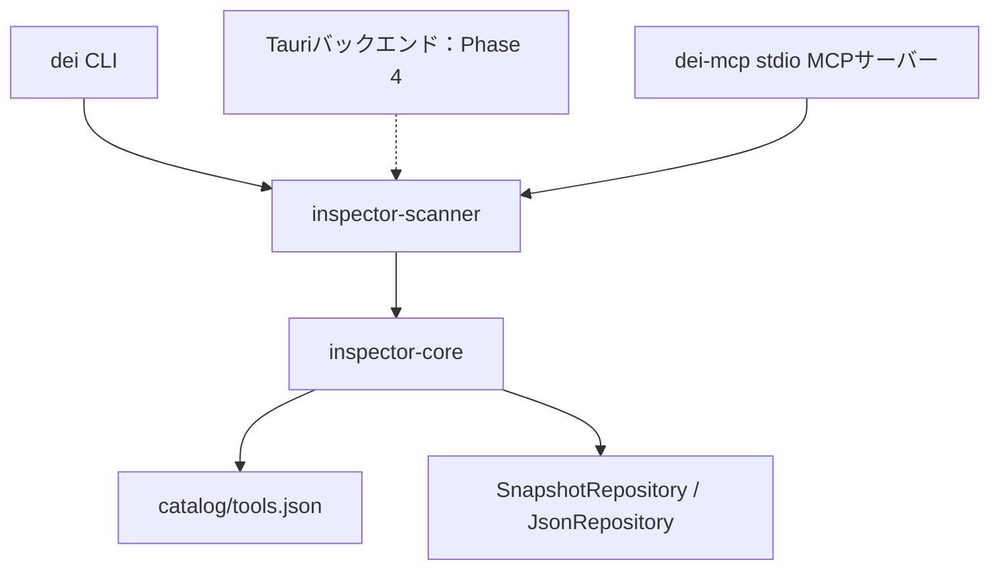

# アーキテクチャ

## 責務と依存方向

Phase 1の検出基盤はGUIやMCPに依存しない。検証用CLIの`dei`とPhase 2の独立MCPサーバーは共通ライブラリを呼び出し、任意コマンド実行機能を提供しない。

| 境界 | 責務 |
| --- | --- |
| `inspector-core` | カタログ、共通データ型、診断コード、出力パスの公開範囲、保存インターフェースとJSON実装 |
| `DiscoveryProvider` | 特定の情報源から候補と取得事実を返す。バージョン実行は担当しない |
| `FileSystem` | 存在確認と読み取り可否を分離し、OS設定変更なしで失敗をテストできる境界 |
| `ScanEngine` | プロバイダーの集約、候補の統合、負荷制限、診断、スナップショット生成 |
| `VersionRunner` | 既知コマンドと実体に対する、制限付きバージョン取得 |
| `NativeVersionRunner` | 固定引数の組み立て、プロセスツリー管理、出力上限、終了待ち、既知出力の解析 |
| `dei` | 明示オプションの解析、実装の接続、公開範囲の指定、JSON出力 |
| `inspector-mcp-server` | MCPプロトコルとの接続、5ツールの引数と応答、メモリー内キャッシュ、スキャンの単一実行枠と再実行間隔 |

`crates/mcp-server`は`scanner`に直接依存する独立実行ファイルを提供し、GUIの起動状態を前提にしない。Phase 4で`apps/desktop`を追加する。Rustモデルや検出処理をReactへ複製せず、Tauriの通信境界で変換する。

MCPでは公式SDK `rmcp`のserver・stdio機能だけを通常依存にする。HTTP・OAuth関連機能は有効にしない。`EnvironmentScanner`をワーカーで実行し、キャッシュと同時実行の制限をMCP層へ置くことで、共通エンジンにプロトコルの責務を持ち込まない。キャンセルでワーカーの実行枠を早期解放しないこと、部分スキャンの範囲を明示することを設計上の制約とする。詳細は[MCP連携](MCP連携.md)を参照する。

## データモデル

`ToolDefinition`はツールの論理的な定義、`Installation`は発見したコマンド候補である。たとえば同じNode.jsでも異なるディレクトリの`node.exe`は別実体として保存する。別名コマンドやシンボリックリンクの同一インストールへの対応付けは、現在は推測しない。

`ToolScan`は定義・実体一覧・診断をまとめる。`ScanSnapshot`にはスキーマ、対象OS、UTCの取得開始・完了時刻、使用した情報源、パスの公開設定、ツール別結果と全体の診断を含める。実体の`detected_at`はそのスキャンの開始時刻を使う。IDはスキャン内で一意な`node-1`等であり、更新間の永続IDとして扱わない。

取得できなかったバージョンとインストール方式は`null`にする。バージョン取得の状態は値と分けるため、未実行・タイムアウト・取得失敗を区別できる。PATH検出だけではインストール方式を確定しない。情報源の申告値は`SourceEvidence`に保持し、実測値を上書きしない。

診断は`code`、`class`（`fact` / `caution`）、`severity`で表す。外部出力由来の自由文を診断メッセージとして保存せず、将来のUIでコードから表示文を生成する。同じ実体の取得元が異なるバージョンを報告した場合は矛盾として記録するが、別実体の異なるバージョンは矛盾にしない。

## 採用した実装方式

新規プロジェクトのため既存依存関係はない。2026-10-22時点のcrates.ioと公式資料を確認し、Rust 1.95で互換性を検証した。具体的な解決バージョンは`Cargo.lock`で固定する。

| 領域 | 選定と理由 |
| --- | --- |
| ファイル確認 | Rust標準ライブラリ。固定名のファイル確認だけなので再帰探索ライブラリは不要 |
| JSON | `serde` / `serde_json`。手作業でJSONを組み立てず、列挙型とスキーマ検証を使用 |
| 日時 | `time`。UTCとRFC 3339の変換を自作しない |
| エラー型 | `thiserror`。呼び出し側で分類できる型を保持し、CLIではローカルパス等を含む生エラーを出力しない |
| 安全な保存 | `tempfile`。同一ディレクトリの一時ファイルに書き込み、同期後に置換する。ファイル名や削除・置換処理を自作しない |
| 非同期実行 | Tokio。標準出力・標準エラーを同時に制限付きで読み、実行時間を制限する |
| Windowsの子プロセス | `process-wrap`のJob Object。実行開始前の割り当て、終了時の子孫プロセス処理を既存実装に任せる |

標準ライブラリの`Child::kill`だけでは子孫全体の終了を扱えないため、プロセス制御用の依存関係を追加した。Windows APIの直接操作による独自実装は避け、プロジェクト側のRustコードでは`unsafe_code`を禁止している。

## 保存と公開範囲

保存先は`SnapshotRepository`で抽象化し、初期実装だけを`JsonRepository`とする。SQLite導入時も`ScanSnapshot`と検出処理を維持し、保存アダプターを追加できる。

内部では実行パスを保持するが、API応答・エクスポート時に`ScanSnapshot::project`を通す。`omit`で全パスを省略し、`redact_home`では指定ホームをパス構成要素単位で置換する。ホームを取得できない場合はパスを省略する。`full`は呼び出し側の明示指定とする。CLIの既定値は`omit`である。

保存時・読込時にスキーマと基本的な整合性を検証する。保存は同一ディレクトリで書き込み、`sync_all`成功後に置換する。書込失敗時に既存ファイルを先に削除しない。Windowsの共有モード・権限等により置換できなければエラーにする。電源断や全ファイルシステムに対する完全な永続性、複数書込者の更新競合の防止までは保証しない。複数書込者は最後に成功した置換が残る。

## 拡張時の前提

- Windows追加プロバイダーは情報源を示した`Candidate`を返し、検出処理と実行処理の分離を維持する。
- プロバイダー失敗や探索の打ち切りを未インストールと解釈しない。
- Linux・WSL追加時にはOS別の探索方針と実行戦略を追加する。現在のスキャナーはWindows用であり、OS列挙型に値があるだけで実装済みとはしない。
- MCPでは共通スキャナーの制限と公開範囲変換を利用し、外部から実行引数・実行パス・カタログ定義を自由指定させない。stdioの標準出力はプロトコル専用にする。

参照：[Rustのプロセスとバッチ処理](https://doc.rust-lang.org/std/process/)、[process-wrap](https://docs.rs/process-wrap/latest/process_wrap/)、[Windows Job Objects](https://learn.microsoft.com/en-us/windows/win32/procthread/job-objects)、[tempfile](https://docs.rs/tempfile/latest/tempfile/struct.NamedTempFile.html)。
