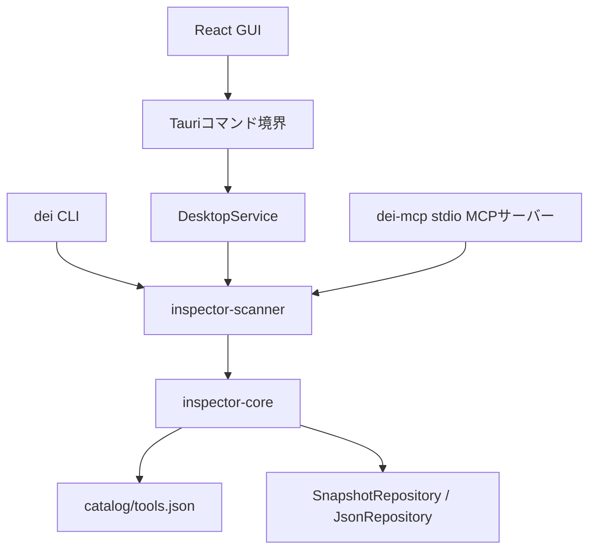

# アーキテクチャ

## 責務と依存方向

Phase 1の検出基盤はGUIやMCPに依存しない。検証用CLIの`dei`とPhase 2の独立MCPサーバーは共通ライブラリを呼び出し、任意コマンド実行機能を提供しない。

| 境界 | 責務 |
| --- | --- |
| `inspector-core` | カタログ、共通データ型、診断コード、出力パスの公開範囲、保存インターフェースとJSON実装 |
| `DiscoveryProvider` | 特定の情報源から候補と取得事実を返す。バージョン実行は担当しない |
| `FileSystem` | 存在確認と読み取り可否を分離し、OS設定変更なしで失敗をテストできる境界 |
| `MetadataFileSystem` / `RegistrySource` | サイズ・階層を制限したメタデータ読み取りとレジストリ観測。フィクスチャへ差し替え可能 |
| `platform::windows_engine` | CLIとMCPで共通のWindowsプロバイダーを構成。`path_engine`はPATH限定用 |
| `ScanEngine` | プロバイダーの集約、候補の統合、負荷制限、診断、スナップショット生成 |
| `VersionRunner` | 既知コマンドと実体に対する、制限付きバージョン取得 |
| `NativeVersionRunner` | 固定引数の組み立て、プロセスツリー管理、出力上限、終了待ち、既知出力の解析 |
| `dei` | 明示オプションの解析、実装の接続、公開範囲の指定、JSON出力 |
| `inspector-mcp-server` | MCPプロトコルとの接続、5ツールの引数と応答、メモリー内キャッシュ、スキャンの単一実行枠と再実行間隔 |
| `apps/desktop/src/api` | Tauri IPCの唯一のフロントエンドアダプターと型定義。画面からinvokeを直接呼ばない |
| `useInspector` | 非同期の状態管理、公開設定変更、前回結果の保持、固定文によるエラー表示 |
| `DesktopService` | GUI専用キャッシュ、単一スキャン枠、再実行間隔、結果の公開範囲変換、保存対象の固定 |

`crates/mcp-server`は`scanner`に直接依存する独立実行ファイルを提供し、GUIの起動状態を前提にしない。`apps/desktop`のTauriバックエンドも同じ`scanner`と`core`を直接利用し、MCPクレートへ依存しない。検出処理と永続化の規則はRustに置き、Reactには表示用の型と状態管理だけを置く。

MCPでは公式SDK `rmcp`のserver・stdio機能だけを通常依存にする。HTTP・OAuth関連機能は有効にしない。`EnvironmentScanner`をワーカーで実行し、キャッシュと同時実行の制限をMCP層へ置くことで、共通エンジンにプロトコルの責務を持ち込まない。キャンセルでワーカーの実行枠を早期解放しないこと、部分スキャンの範囲を明示することを設計上の制約とする。詳細は[MCP連携](MCP連携.md)を参照する。

## GUIの通信と保存

Tauriのmainウィンドウに、同梱コンテンツからの4コマンドだけを許可する。アプリの権限は`build.rs`の`AppManifest`から生成し、capabilityを`main-inspection`へ限定する。JavaScript向けのシェル・ファイルシステム・外部URL起動機能は公開しない。外部サイトからのIPCを許可せず、製品版のCSPは外部接続と外部アセットを認めない。開発時のみViteのローカル接続を許可する。

| コマンド | 引数 | 結果・影響 |
| --- | --- | --- |
| `get_catalog` | なし | 同梱カタログ。検出や外部CLI起動は行わない |
| `get_snapshot` | `paths` | キャッシュの公開範囲を変えた`SnapshotView`、または未スキャンならnull |
| `scan_environment` | `request: {probe_versions, path_only, paths}` | 既知の全カタログを再検出し、`{revision, snapshot}`を返す |
| `export_snapshot` | `request: {revision, paths}` | Rust側でWindows保存ダイアログを開き、`saved`または`cancelled`を返す |

スキャン・保存の`request`内の未知フィールドを拒否する。任意コマンド、任意の探索パスや保存パスを受け付けるAPIは設けない。`paths`は`omit`、`redact_home`、`full`の列挙型である。画面表示の既定は`redact_home`、JSON保存の既定は`omit`とし、両方の設定を分ける。全パスを保持する内部キャッシュから必要な公開範囲へ変換するため、表示範囲の変更に再スキャンは不要である。

スキャンはブロッキングワーカー上で動かし、プロセスごとに同時1件、完了から次回まで2秒以上とする。IPCの呼出しがキャンセルされてもワーカー終了まで実行枠を保持する。失敗時は成功済みのスナップショット・日時・revisionを維持する。GUIとMCPは独立したプロセスなので、キャッシュと実行枠を共有しない。

保存では、表示中のrevisionが最新キャッシュに一致することを確認し、ダイアログを開く時点の結果を固定する。ダイアログ中に別のスキャンが完了しても保存対象をすり替えない。保存ダイアログは同時1件、キャンセル時は書き込みなしとし、選択されたJSONファイルへ`JsonRepository`でアトミック保存する。フロントエンドからスナップショット本文や保存先を受け取らず、キャッシュ済みの観測結果だけを書き出す。エラーは固定の`{code}`として返し、生のI/Oエラーや個人パスを表示・ログへ反射しない。

フロントエンドの契約型は`api/contracts.ts`に集約し、通信と非同期操作の状態を`useInspector`に分離する。RustとReactのテストで同じJSONフィクスチャを使い、モデル変更時の確認点を通信境界にまとめる。型の自動生成ライブラリや追加の状態管理ライブラリは使わない。参照デザインに基づく画面は、検索・絞り込み・行内詳細を持つInventory、Diagnostics、MCP、Settingsに分ける。表示の変更に検出エンジンやIPCの追加は必要ない。

パスのコピーは標準Clipboard APIによる明示操作だけで行い、表示用に変換した値だけを書き込む。クリップボードの読込権限やTauriの汎用ファイル・シェル権限は追加しない。MCP画面は設定案内であり、独立プロセスの接続監視やキャッシュ共有を実装したものではない。

## データモデル

`ToolDefinition`はツールの論理的な定義、`Installation`は発見したコマンド候補である。たとえば同じNode.jsでも異なるディレクトリの`node.exe`は別実体として保存する。別名コマンドやシンボリックリンクの同一インストールへの対応付けは、現在は推測しない。

`ToolScan`は定義・実体一覧・製品登録一覧・診断をまとめる。`Registration`は製品登録やnpmパッケージの申告情報であり、実行ファイルが見つからなくても保持する。`Installation`の代わりに架空の実行候補を作らない。製品登録と実体の件数は別に数え、同じ製品が両方に現れてもインストール数として加算しない。

`ScanSnapshot`にはスキーマ、対象OS、UTCの取得開始・完了時刻、使用した情報源、パスの公開設定、ツール別結果と全体の診断を含める。実体・登録の`detected_at`はスキャン開始時刻を使う。IDはスキャン内で一意な`node-1`や`node-registration-1`等であり、永続IDとして扱わない。レジストリの生キー名は統合にだけ使い、保存・応答に残さない。

取得できなかったバージョンとインストール方式は`null`にする。バージョン取得の状態は値と分けるため、未実行・タイムアウト・取得失敗を区別できる。PATH検出だけではインストール方式を確定しない。情報源の申告値は`SourceEvidence`に保持し、実測値を上書きしない。

診断は`code`、`class`（`fact` / `caution`）、`severity`で表す。外部出力由来の自由文を診断メッセージとして保存せず、将来のUIでコードから表示文を生成する。同じ実体の取得元が異なるバージョンを報告した場合は矛盾として記録するが、別実体の異なるバージョンは矛盾にしない。

## 採用した実装方式

新規プロジェクトのため既存依存関係はない。2026-10-22時点のcrates.ioと公式資料を確認し、Rust 1.95で互換性を検証した。具体的な解決バージョンは`Cargo.lock`で固定する。

| 領域 | 選定と理由 |
| --- | --- |
| ファイル確認 | Rust標準ライブラリ。固定名のファイル確認だけなので再帰探索ライブラリは不要 |
| JSON | `serde` / `serde_json`。手作業でJSONを組み立てず、列挙型とスキーマ検証を使用 |
| 日時 | `time`。UTCとRFC 3339の変換を自作しない |
| エラー型 | `thiserror`。呼び出し側で分類できる型を保持し、CLIではローカルパス等を含む生エラーを出力しない |
| 安全な保存 | `tempfile`。同一ディレクトリの一時ファイルに書き込み、同期後に置換する。ファイル名や削除・置換処理を自作しない |
| 非同期実行 | Tokio。標準出力・標準エラーを同時に制限付きで読み、実行時間を制限する |
| Windowsの子プロセス | `process-wrap`のJob Object。実行開始前の割り当て、終了時の子孫プロセス処理を既存実装に任せる |
| レジストリ | `winreg 0.56.0`（MIT、Rust 1.60以上）。標準ライブラリにAPIがないため採用。読み取り権限だけで既知キーを開き、独自のunsafeなWin32呼出しを避ける |
| デスクトップ | Tauri 2.12.5、tauri-build 2.7.4、tauri-plugin-dialog 2.8.3。IPC・権限・ネイティブ保存ダイアログを公式機能に任せる |
| GUI | React 19.3.1、Vite 8.3.5、TypeScript 7.0.2。CSS・同梱SVG・標準フォーム要素を使い、デザインシステムやアニメーション依存を追加しない |
| 画面テスト | Vitest 5.0.5、Testing Library、jsdom。実機ツールに触れずに非同期操作と失敗・キャンセルの状態を確認する |

標準ライブラリの`Child::kill`だけでは子孫全体の終了を扱えないため、プロセス制御用の依存関係を追加した。Windows APIの直接操作による独自実装は避け、プロジェクト側のRustコードでは`unsafe_code`を禁止している。

## 保存と公開範囲

保存先は`SnapshotRepository`で抽象化し、初期実装だけを`JsonRepository`とする。SQLite導入時も`ScanSnapshot`と検出処理を維持し、保存アダプターを追加できる。

内部では実行パス・製品登録の配置パスを保持するが、API応答・エクスポート時に両方を`ScanSnapshot::project`へ通す。`omit`で全パスを省略し、`redact_home`では指定ホームをパス構成要素単位で置換する。ホームを取得できない場合はパスを省略する。`full`は呼び出し側の明示指定とする。CLIの既定値は`omit`である。

保存時・読込時にスキーマと基本的な整合性を検証する。保存は同一ディレクトリで書き込み、`sync_all`成功後に置換する。書込失敗時に既存ファイルを先に削除しない。Windowsの共有モード・権限等により置換できなければエラーにする。電源断や全ファイルシステムに対する完全な永続性、複数書込者の更新競合の防止までは保証しない。複数書込者は最後に成功した置換が残る。

## 拡張時の前提

- プロバイダーは情報源を示した`Candidate`と、実行可否を伴わない`RegistrationObservation`を返し、検出処理と実行処理の分離を維持する。
- プロバイダー失敗や探索の打ち切りを未インストールと解釈しない。
- Linux・WSL追加時にはOS別の探索方針と実行戦略を追加する。現在のスキャナーはWindows用であり、OS列挙型に値があるだけで実装済みとはしない。
- MCPでは共通スキャナーの制限と公開範囲変換を利用し、外部から実行引数・実行パス・カタログ定義を自由指定させない。stdioの標準出力はプロトコル専用にする。

参照：[Rustのプロセスとバッチ処理](https://doc.rust-lang.org/std/process/)、[process-wrap](https://docs.rs/process-wrap/latest/process_wrap/)、[Windows Job Objects](https://learn.microsoft.com/en-us/windows/win32/procthread/job-objects)、[tempfile](https://docs.rs/tempfile/latest/tempfile/struct.NamedTempFile.html)。

GUIの根拠：[TauriのRustコマンド](https://v2.tauri.app/develop/calling-rust/)、[capabilities](https://v2.tauri.app/security/capabilities/)、[Dialogプラグイン](https://v2.tauri.app/plugin/dialog/)、[Windowsの前提条件](https://v2.tauri.app/start/prerequisites/#windows)、[ViteのNode.js要件](https://vite.dev/guide/)。
